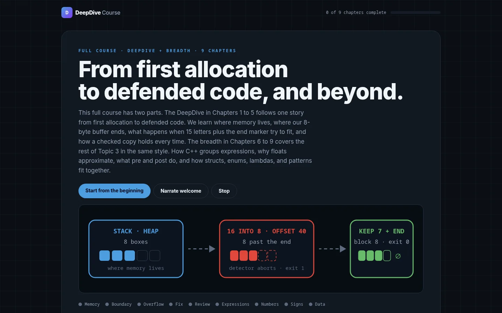

# DeepDive

**A nine-chapter interactive C++ memory-safety course with simulations, narration, and films.**

[Live course](https://nyght-x-walker.github.io/DeepDive/) · [Static course source](course/) · [Astro site](website/)



## What it covers

DeepDive turns C++ memory safety into a guided, visual course instead of a list of warnings. The course combines:

- Interactive memory-layout simulations
- Narrated lessons and chapter audio
- Short films and visual explainers
- C++ examples built around AddressSanitizer
- Handouts, slides, and a final review

## How it works

- `course/` contains the static course pages deployed to GitHub Pages.
- `website/` contains the Astro + React site used for the course shell.
- `animation/` contains the Manim sources for the visual explainers.
- `course/audio/` contains the narrated lesson audio.

## Run locally

The static course has no build step. Open `course/index.html` in a browser.

To work on the Astro site:

```bash
cd website
npm install
npm run dev
```

The dev server runs at `http://localhost:4321`.

## Deployment

The GitHub Actions workflow in `.github/workflows/deploy.yml` publishes `course/` to GitHub Pages on every push to `master`.

## Status

Live course. The static course is the primary learning surface; the Astro site is the presentation layer for the course shell.
